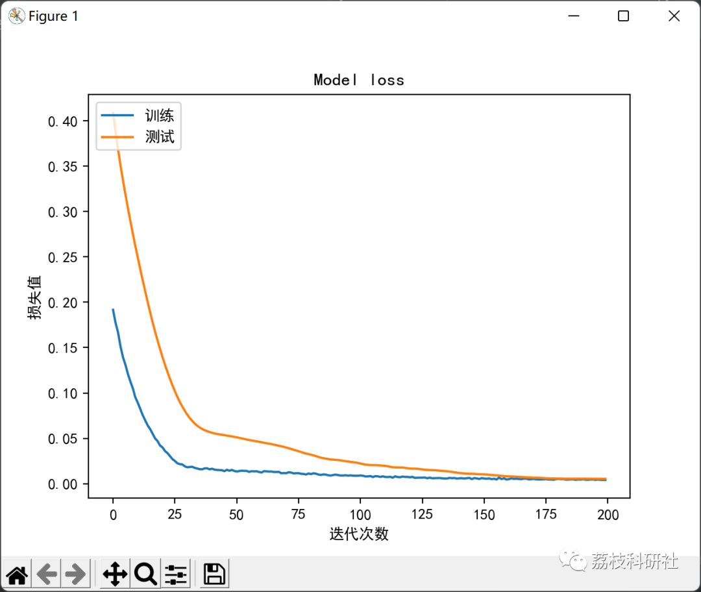
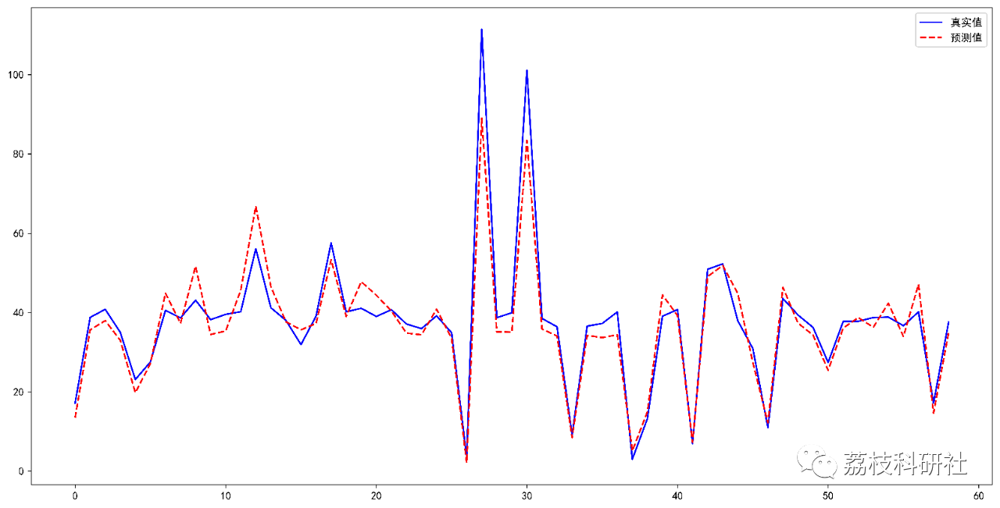
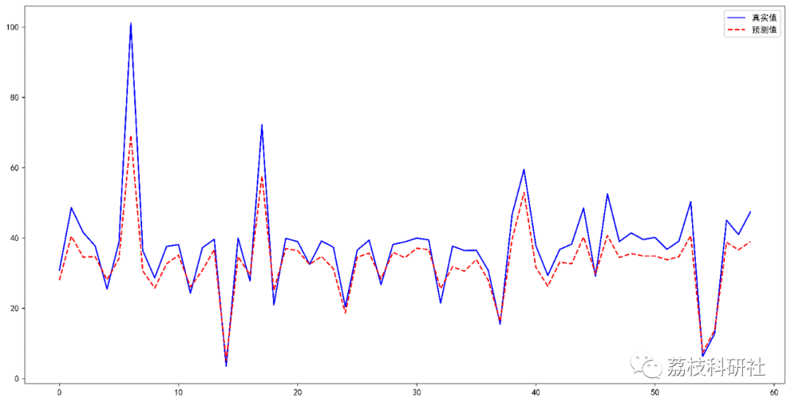

# Prediction of Electricity Consumption Based on BP Neural Network (Python Code Implementation)

💥💥💥💞💞💞💞 Welcome to this blog❤️❤️❤️💥💥💥
🏆 Bloggers' Advantage: 🌞🌞🌞 The content of the blog strives to be rigorous in thought and clear in logic, for the convenience of readers.
⛳️ Mantra: The journey of a hundred miles is half done in the last ninety.
🎁Column Directory Link:
🌈🌈🌈🌟🌟🌟Electrical Code Intelligent Algorithm and Its Application Path Planning Neural Network Predictive Optimization Scheduling Image Processing Workshop Scheduling Signal Processing Romantic Her My Philosophical Thoughts Math Modeling Complete Code Matters
💥1 Overview
With the development of modern information technology, smart grid has become one of the main components of smart cities. To fully leverage the capabilities of smart grids, intelligent scheduling and planning for power transmission are crucial. In practice, many factors can affect power consumption, which requires the use of information fusion technology to thoroughly understand power consumption. To this end, researchers have studied methods for collecting information on electricity consumption and various multi-factor electricity consumption prediction models. In addition, conducting a comprehensive analysis and obtaining accurate power consumption assessments are the premises and foundations for more robust and efficient grid design and renovation. Therefore, it is of great significance to explore the prediction model that can effectively reflect the change of electricity consumption and internal relationship in integrated information. Predicting electricity consumption based on neural networks has become a popular research topic in recent years, and the BP neural network algorithm has been recognized as a mature and effective method.
📚2 Running Results
📃2.1 Comparison of model loss and val_loss
📃2.2 Actual values and true values
🎉3 Python code implementation
Click the "Read More" button at the bottom left of the article.
Or reply with the keyword: BP neural network-based electricity consumption prediction
​  
👨‍💻4 References
[1] Du Kun. Research on Short-Term Load Forecasting Based on BP Neural Network [D]. Hebei University of Science and Technology, 2021. DOI: 10.27107/d.cnki.ghbku.2021.000668.

## Images

<!-- PAYMENT_BLOCK -->

## Get this dataset

- Payment link (Stripe): [Buy now](https://buy.stripe.com/3cs8yP7sY87d0vu9AB)
- Payment QR code: 

<!-- /PAYMENT_BLOCK -->
